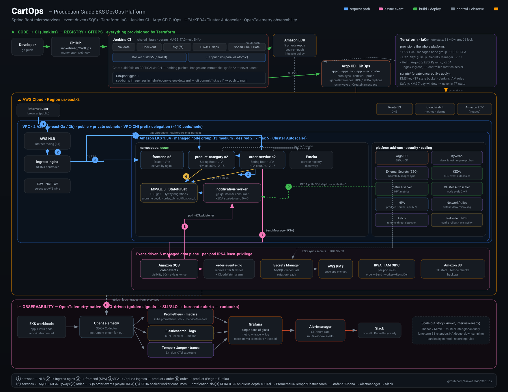

<div align="center">

# 🛒 CartOps

### A production-grade, event-driven e-commerce platform on **Amazon EKS** — built the way real SRE/DevOps teams run software.

*Spring Boot microservices · Terraform IaC · Jenkins CI · Argo CD GitOps · KEDA event-autoscaling · LGTM + OpenTelemetry observability*

<br/>


</div>

<br/>

<div align="center">
  
  <br/>
  <sub><i>End-to-end flow — from a browser request, through the synchronous API path and the asynchronous SQS event path, to full LGTM + OpenTelemetry observability. Every box is a real component in this repo.</i></sub>
</div>

<br/>

---

## 💡 What this is (and why it's different)

Most "e-commerce microservices" repos stop at the code. **CartOps goes all the way to production.** It's a Spring Boot backend that is *actually deployed* on a live Amazon EKS cluster and operated with the exact toolchain and patterns used by platform/SRE teams at scale: infrastructure as code, a security-gated CI pipeline, GitOps continuous delivery, event-driven autoscaling, defence-in-depth security, and SLO-driven observability.

The guiding principle behind every decision: **solve the real production problem, not the demo version of it.** Scale-to-zero on an empty queue. Zero-downtime rollouts. Per-pod IAM. Immutable, traceable image tags. State that survives a cluster teardown. The kind of thing you only learn by hitting the failure first.

> **TL;DR for a hiring team:** this isn't a tutorial cluster. It's a platform you can open the terminal on and walk through — every arrow in the diagram above maps to running infrastructure and committed code.

---

## 🧭 End-to-end flow (follow the numbers in the diagram)

| # | Step | What happens |
|---|------|--------------|
| **1–2** | Edge | Browser → internet-facing **AWS NLB** → **ingress-nginx** controller |
| **3** | Static | Ingress routes `/` to the **React (Vite)** frontend, served by nginx |
| **4** | API | Ingress routes `/api/*` to **product-category** and **order-service** |
| **5** | Sync call | `order-service` resolves `product-category` through **Eureka** and calls it via an **OpenFeign** client |
| **6** | Data | Services persist to **MySQL 8** (StatefulSet on **EBS gp3**), schema managed by **Flyway** |
| **7** | Async publish | On a new order, `order-service` publishes an event to **Amazon SQS** (`order-events`) — authenticated by **IRSA**, no static keys |
| **8** | Event consume | **KEDA**-scaled `notification-worker` consumes the event via `@SqsListener` and writes `notification_db` |
| **9** | Elastic scale | KEDA polls queue depth and scales the worker **0 → 5**; HPA scales the API pods on CPU; Cluster Autoscaler adds nodes |
| **10** | Observe | **OpenTelemetry** fans telemetry out to **Prometheus / Loki / Tempo** → **Grafana** single pane → **Alertmanager** → **Slack** |

Two independent paths, one platform: a **synchronous request path** (blue) for user-facing reads/writes, and an **asynchronous event path** (pink) that decouples slow/side-effecting work so the checkout never waits on a notification.

---

## 🧩 The code — microservices

| Service | Stack | Port | Role | Scaling |
|---------|-------|------|------|---------|
| **product-category** | Spring Boot 3.5, JPA, Flyway, Retrofit | 8080 | Product catalogue & categories; pulls external data from FakeStore API | HPA 2→5 (CPU 60%) |
| **order-service** | Spring Boot 3.5, JPA, OpenFeign, AWS SDK v2 | 7878 | Places orders, calls product service, **publishes order events to SQS** | HPA 2→5 (CPU 60%) |
| **notification-worker** | Spring Boot 3.5, Spring Cloud AWS | 9090 | **Consumes SQS order events** (`@SqsListener`), writes notifications | **KEDA 0→5** (queue depth) |
| **eureka-server** | Spring Cloud Netflix Eureka | 8761 | Service registry — services discover each other by name | 1 |
| **frontend** | React 18 + Vite, nginx | 80 | Single-page storefront UI | 2 |
| **mysql** | MySQL 8, StatefulSet, EBS gp3 | 3306 | Persistent store — `ecommerce_db`, `order_db`, `notification_db` | StatefulSet |

Clean layering in each service — controllers → services → repositories → entities/DTOs with mappers, centralised `@ControllerAdvice` exception handling, and JUnit 5 + Mockito tests.

---

## ⚡ Event-driven architecture (the async path)

The checkout flow is **decoupled** so a slow downstream never blocks a customer:

```
order-service ──SendMessage──▶ Amazon SQS: order-events ──poll──▶ notification-worker
    (IRSA: SendMessage only)      │  visibility 60s                  (@SqsListener)
                                  │  at-least-once                    │
                                  └── after N retries ──▶ order-events-dlq ──▶ CloudWatch alarm
```

- **Scale-to-zero** — when the queue is empty, KEDA runs **0** worker pods. Cost is zero when there's no work; capacity appears within seconds of a backlog.
- **At-least-once + idempotency** — SQS guarantees delivery; the consumer is designed to tolerate re-delivery (`ON_SUCCESS` ack — a message is only removed after it's successfully processed).
- **Poison-message safety** — messages that keep failing are redriven to a **dead-letter queue**, and a **CloudWatch alarm** fires when the DLQ is non-empty, so failures surface instead of silently disappearing.
- **Least privilege** — `order-service` can *only* `SendMessage`; the worker can *only* receive/delete. Enforced by **IRSA** (IAM Roles for Service Accounts) — a compromised pod can't touch any other AWS resource.

---

## 🛠️ Tech stack & tooling

| Layer | Technologies |
|-------|--------------|
| **Application** | Java 17 · Spring Boot 3.5 · Spring Data JPA / Hibernate · Spring Cloud Netflix Eureka · OpenFeign · Spring Cloud AWS · AWS SDK v2 (SQS) · Flyway · MySQL 8 · React 18 + Vite · JUnit 5 + Mockito |
| **Containers & orchestration** | Docker (multi-stage, BuildKit cache mounts, non-root) · Kubernetes 1.34 on **Amazon EKS** · Helm (single umbrella chart, dev/prod value overlays) |
| **CI — Jenkins** | Shared pipeline library · Trivy (filesystem scan) · OWASP Dependency-Check · SonarQube + quality gate · parallel build & ECR push ×5 · immutable `:<gitSHA>` tags |
| **CD — GitOps** | **Argo CD** app-of-apps · auto-sync · self-heal · prune · `ignoreDifferences` for HPA/KEDA-managed replicas |
| **IaC — Terraform** | EKS · managed node group · OIDC/IRSA · VPC · ECR · SQS (+DLQ) · Secrets Manager · platform Helm releases (Argo CD, ESO, Kyverno, KEDA, ingress, LBC) · remote state (**S3 + DynamoDB** lock) |
| **Scaling & reliability** | HPA · **KEDA** (event-driven, scale-to-zero) · Cluster Autoscaler · PodDisruptionBudget · topology spread · rolling updates |
| **Security** | IRSA · External Secrets Operator + Secrets Manager + KMS · Kyverno policies · NetworkPolicy · Falco · PSA · RBAC |
| **Observability — LGTM + OTel** | OpenTelemetry (SDK + Collector) · Prometheus · Grafana · Loki + Fluent Bit · Tempo + Jaeger · Alertmanager → Slack |

---

## 🏗️ Platform capabilities — the production details

<details>
<summary><b>🔐 Security — defence in depth (6 layers)</b></summary>

<br/>

- **Identity (IRSA):** every pod assumes its own IAM role via the EKS **OIDC** provider — scoped to exactly the APIs it needs. No long-lived AWS keys anywhere in the cluster.
- **Secrets:** **External Secrets Operator** syncs credentials from **AWS Secrets Manager** into Kubernetes Secrets; encryption at rest via **KMS** envelope encryption. No plaintext passwords in Git or manifests.
- **Admission control (Kyverno):** policies reject bad deploys at the door — `deny :latest`, require resource limits, require probes.
- **Network (NetworkPolicy):** default-deny micro-segmentation with an explicit allow-list — only the services that *should* reach MySQL can.
- **Runtime (Falco):** detects anomalous syscalls/behaviour inside running containers.
- **Standards (PSA + RBAC):** Pod Security Admission baseline, least-privilege RBAC for every ServiceAccount.

</details>

<details>
<summary><b>📈 Scaling — three independent autoscalers, working together</b></summary>

<br/>

- **HPA** scales `product-category` and `order-service` on CPU (target 60%, 2→5 replicas) — handles user-traffic spikes.
- **KEDA** scales `notification-worker` on **SQS queue depth**, including **scale-to-zero** — handles bursty async work with no idle cost.
- **Cluster Autoscaler** adds/removes nodes (t3.medium, 2→5) when pods can't be scheduled.
- Sized together on purpose: HPA `maxReplicas` and the node group `max_size` are matched so scaling never hits a silent ceiling. *(Karpenter migration is on the roadmap.)*

</details>

<details>
<summary><b>🔄 CI/CD — security-gated pipeline → GitOps delivery</b></summary>

<br/>

**CI (Jenkins):** `validate → checkout → Trivy → OWASP → SonarQube + gate → build ×5 (parallel) → ECR push ×5 (parallel) → bump values-dev.yaml → git push`.
- Builds **fail closed** on CRITICAL/HIGH findings — a vulnerable image never reaches the registry.
- Images are tagged with the **immutable git SHA** (never `:latest`) — every running pod is traceable to an exact commit, and rollback is deterministic.
- Builds and pushes run in parallel (~3 min instead of ~12 sequential).

**CD (Argo CD):** the pipeline commits the new tag to Git; Argo CD detects the change and runs `helm upgrade` automatically — **Git is the single source of truth**, and the cluster self-heals back to declared state if it ever drifts.

</details>

<details>
<summary><b>📊 Observability — SLO-driven, not "tools installed"</b></summary>

<br/>

Instrument **once** with OpenTelemetry; the Collector fans telemetry out to swappable backends:
- **Metrics** → Prometheus (kube-prometheus-stack, ServiceMonitors) → Grafana
- **Logs** → Fluent Bit (DaemonSet) → Loki (S3-backed) → Grafana
- **Traces** → Tempo + Jaeger (dual OTel exporters) → Grafana

The story is **golden signals → SLI/SLO → burn-rate alerts → runbooks**, with single-pane correlation in Grafana (metric exemplar → trace → logs by `trace_id`). Scale-out answer is known and ready: **Thanos/Mimir** for multi-cluster global query, long-term retention, and HA — with cardinality control and recording rules.

</details>

<details>
<summary><b>🧱 Infrastructure as Code — Terraform, done safely</b></summary>

<br/>

- Everything reproducible from `terraform apply` — EKS, IRSA/OIDC, ECR, SQS, Secrets Manager, and all platform Helm releases.
- **Remote state** in S3 with DynamoDB locking.
- **Scripts vs Terraform split:** long-lived resources with deletion windows (**KMS keys**, the state bucket, Jenkins IAM roles) live in `scripts/` and are referenced via `data` sources — so daily `apply`/`destroy` cycles for a dev cluster never accumulate orphaned KMS keys or fight mandatory deletion timers.

</details>

---

## 📁 Repository structure

```
CartOps/
├── ProductAndCategoryMicroservice/   # Spring Boot — catalogue service
├── orderMicroservice/                # Spring Boot — orders + SQS publisher
├── notificationWorker/               # Spring Boot — SQS consumer (KEDA-scaled)
├── Servicediscoverywitheureka/       # Eureka service registry
├── frontend/                         # React + Vite storefront
├── helm/ecom/                        # Umbrella Helm chart (all services + platform objects)
│   └── templates/                    # deployments, HPA, KEDA ScaledObject, NetworkPolicy,
│                                     #   ESO ExternalSecret, Kyverno policies, PDB, ingress…
├── terraform/                        # EKS, IRSA, ECR, SQS, Secrets Manager, Helm releases
├── CICD/                             # Jenkins pipelines (dev-build, dev-deploy)
├── GitOps/                           # Argo CD app-of-apps (root-app → ecom-dev)
├── scripts/                          # KMS key, state backend, Jenkins IAM bootstrap, destroy
├── Interview/                        # DevOps interview Q&A grounded in this build
└── screenshots/architecture.svg      # the diagram above
```

---

## 🎙️ What I can walk you through

Because this platform is **actually running**, I can open a terminal and demonstrate — not just describe:

- A code push flowing through Jenkins → ECR → Argo CD → a zero-downtime rollout.
- KEDA scaling the worker from **0 to N** as I push messages onto the queue, then back to **0**.
- An HPA scale-out under load, followed by Cluster Autoscaler adding a node.
- A secret rotating in Secrets Manager and propagating into pods.
- Grafana correlating a latency spike → trace → logs in one pane.
- Why a pod can (or can't) reach MySQL — live NetworkPolicy + IRSA.

The `Interview/` folder captures the *why* behind each decision as real interview Q&A (general, scenario, and incident/war-story style), grounded entirely in what's built here.

---

## 🚀 Status

**Live** on Amazon EKS (`us-east-2`) · GitOps-managed · 6 services across the `ecom` namespace · operated daily via `apply`/`destroy` cycles that preserve stateful data.

---

<div align="center">

### Author

**Sanket Walunj** — DevOps / Platform Engineer
[GitHub](https://github.com/sanketire45) · [LinkedIn](https://linkedin.com/in/sanket-walunj)

<sub>Built to production standards. Every component in the diagram is real, committed, and explainable.</sub>

</div>
